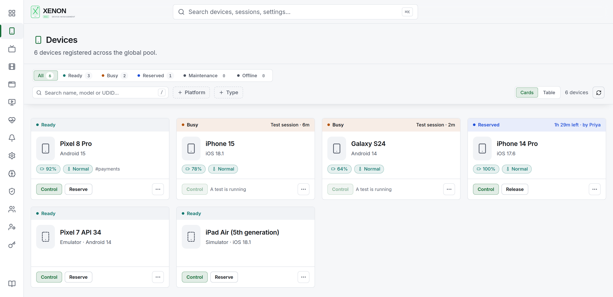
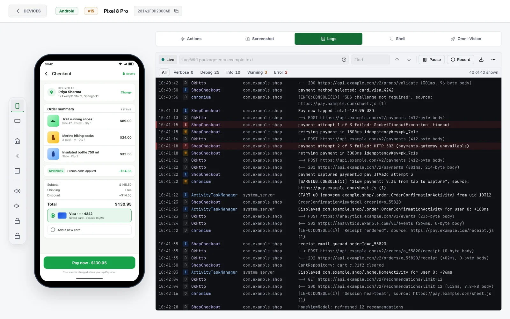
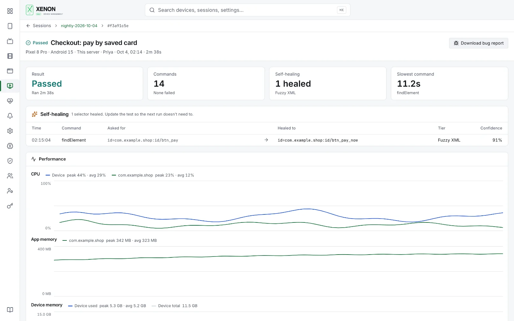
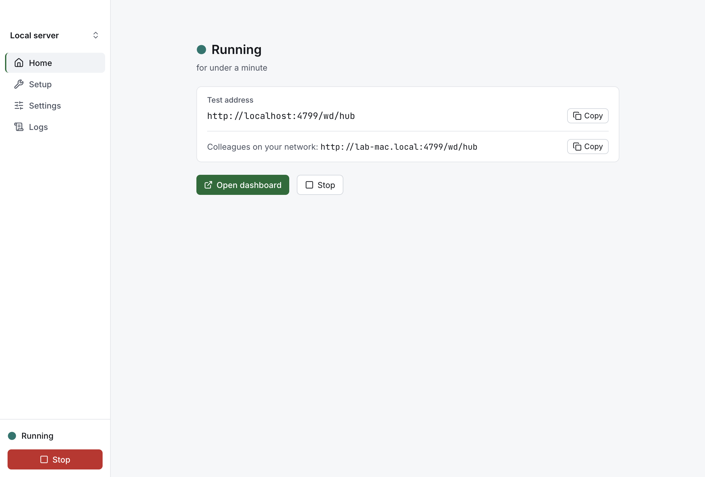
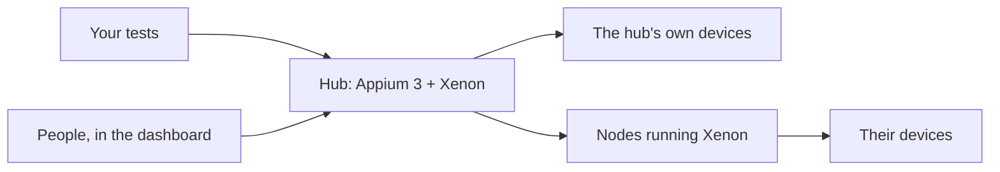

<h1 align="center">
  <picture>
    <source media="(prefers-color-scheme: dark)" srcset="assets/logo-dark.svg">
    
  </picture>
</h1>

<p align="center">
  <strong>Run your mobile device lab from one place: allocation, live control, recording and self-healing tests, as an Appium 3 plugin.</strong>
</p>

<p align="center">
  <a href="https://www.npmjs.com/package/@xenon-device-management/xenon"></a>
  <a href="https://github.com/Rabindra184/xenon/actions/workflows/npm-publish.yml"></a>
  <a href="https://appium.io"></a>
  <a href="https://nodejs.org"></a>
  <a href="LICENSE"></a>
</p>

<p align="center">
  <a href="#quick-start">Quick start</a> ·
  <a href="https://xenon-6e6.pages.dev">Documentation</a> ·
  <a href="#xenon-control-for-mac">Mac app</a> ·
  <a href="https://xenon-6e6.pages.dev/api">API reference</a> ·
  <a href="CHANGELOG.md">Changelog</a>
</p>

<p align="center">
  <picture>
    <source media="(prefers-color-scheme: dark)" srcset="assets/dashboard-dark.png">
    
  </picture>
</p>

Xenon sits inside Appium and turns a set of Android and iOS devices, real or virtual, on one machine or many, into a shared lab. Tests ask for a device with ordinary Appium capabilities. Xenon picks a free one the caller is allowed to use, records the session, heals selectors that broke, and shows everything on a live dashboard. People use the same dashboard to watch, control, record and reserve devices.

Your tests keep their Appium client and their code: pointing them at Xenon is a change of URL and a few capabilities.

## Contents

- [Highlights](#highlights)
- [Requirements](#requirements)
- [Quick start](#quick-start)
- [Xenon Control for Mac](#xenon-control-for-mac)
- [Hub and nodes](#hub-and-nodes)
- [Configuration](#configuration)
- [Capabilities for your tests](#capabilities-for-your-tests)
- [Clients, SDKs and the API](#clients-sdks-and-the-api)
- [Self-healing](#self-healing)
- [Security and access](#security-and-access)
- [Observability](#observability)
- [Troubleshooting](#troubleshooting)
- [Upgrading](#upgrading)
- [Development](#development)
- [Documentation](#documentation)
- [Getting help](#getting-help) · [Contributing](#contributing) · [License](#license)

## Highlights

**[Device lab](https://xenon-6e6.pages.dev/docs/devices)**
- Finds Android devices and emulators (adb), and iPhones and iOS simulators on a Mac, by itself.
- Allocates a free, healthy device per session, and queues requests when none is free.
- One hub, many nodes: every machine's devices form one pool, behind one URL and one set of rules.
- Teams decide who may use which device; reservations and programmatic leases hold one for a person or a pipeline.

**[Live control](https://xenon-6e6.pages.dev/docs/device-control)**
- Live preview of any device in the browser (MJPEG, or an optional hardware H.264 stream on Android).
- Tap, swipe, type, press keys, take screenshots, install apps and read the clipboard remotely.
- Streaming Android logs with filters, and an [inspector](https://xenon-6e6.pages.dev/docs/inspector) with the element tree, suggested locators and generated test code.
- [Record](https://xenon-6e6.pages.dev/docs/recordings) several phones side by side, draw marks on their screens while they record, and download a proof bundle.

**[Test evidence](https://xenon-6e6.pages.dev/docs/sessions)**
- Video, screenshots, the phone's device logs and the full command log for every session, grouped by build.
- CPU and memory charts per session ([on an iPhone, CPU only](https://xenon-6e6.pages.dev/docs/cpu-and-memory)).
- Android: [network capture](https://xenon-6e6.pages.dev/docs/network-interceptor) with mocks and HAR export, and [network profiles](https://xenon-6e6.pages.dev/docs/network-conditioning) from added latency to `Offline`.
- A failed session is [filed into a category](https://xenon-6e6.pages.dev/docs/failure-analysis) with a runbook and, with an AI provider, a likely cause. A bug report bundles a session's evidence in one click.

**[Self-healing](#self-healing)**
- When `findElement` fails, six escalating strategies look for the element, from stored fingerprints to an LLM.
- The **Selector health** page lists the selectors that needed healing, with a suggested fix to copy into your test.
- [Omni-Vision](https://xenon-6e6.pages.dev/docs/omni-vision) finds elements by the text on screen (OCR, on the server) or by a description (your AI provider), with the `-custom:ai-text` and `-custom:ai-icon` locators.

**Built for teams**
- Users, roles (`SUPER_ADMIN`, `ADMIN`, `MEMBER`), teams and scoped API tokens.
- [Webhooks](https://xenon-6e6.pages.dev/docs/notifications), to Slack or your own endpoint, when a phone goes offline or appears, a session fails, or the selector digest goes out.
- Per-user rate limits, single-use tickets for streams and downloads, and a complete [OpenAPI reference](#clients-sdks-and-the-api).

<table>
  <tr>
    <td width="50%">
      <picture>
        <source media="(prefers-color-scheme: dark)" srcset="website/static/img/screens/device-control-dark.webp">
        
      </picture>
    </td>
    <td width="50%">
      <picture>
        <source media="(prefers-color-scheme: dark)" srcset="website/static/img/screens/session-dark.webp">
        
      </picture>
    </td>
  </tr>
  <tr>
    <td align="center"><b>Device control</b>: the phone's screen and its live logs</td>
    <td align="center"><b>A session</b>: its result, the selector it healed, CPU and memory</td>
  </tr>
</table>

## Requirements

| Component | Needed |
|---|---|
| **Node.js** | 20.19 or later in the 20 line, 22.12 or later in the 22 line, or 24 and later, with npm 10 or later: Appium 3's own range |
| **Appium** | 3.1.1 or later in the 3 line (`npm i -g appium`) |
| **Android** | The Android SDK platform tools (`adb`), with `ANDROID_HOME` set to the SDK's folder, and the UiAutomator2 driver |
| **iOS** | A Mac with Xcode and the XCUITest driver. From 2.18, Xenon brings its own go-ios for real iPhones; 2.17 and earlier need one command ([below](#quick-start)) |
| **Database** | SQLite, built in: a file under `~/.cache/xenon`. Each server, hub or node, keeps its own. |
| **Recording** | ffmpeg, which comes with Xenon |
| **Optional** | An AI provider (Gemini, OpenAI, Anthropic or a local Ollama) for the AI healing tiers, Omni-Vision's AI vision and failure analysis |

[Installation and requirements](https://xenon-6e6.pages.dev/docs/installation) has the details, and where Xenon keeps its data. On a Mac, [Xenon Control](#xenon-control-for-mac) checks all of this for you.

## Quick start

You need a device Xenon can use, connected or booted: an Android phone with USB debugging on, an Android emulator, an iPhone or an iOS simulator.

**1. Install the plugin and a driver.**

```bash
appium plugin install --source=npm @xenon-device-management/xenon
appium driver install uiautomator2      # Android
appium driver install xcuitest          # iOS (macOS only)
```

**2. Start Appium with Xenon.** For Android, export `ANDROID_HOME` in that shell first: Xenon finds `adb` through it.

```bash
export ANDROID_HOME=~/Library/Android/sdk   # where Android Studio puts it on a Mac
appium server --use-plugins=xenon \
  --plugin-xenon-platform=both \
  --plugin-xenon-enable-dashboard
```

The dashboard is always served; `--plugin-xenon-enable-dashboard` records your sessions for its **Sessions** and **Selector Health** pages.

With Xenon 2.17 or earlier, real iPhones also need Xenon's copy of go-ios: run `node "${APPIUM_HOME:-$HOME/.appium}/node_modules/@xenon-device-management/xenon/lib/src/scripts/install-go-ios.js"` once, and again after each upgrade.

**Trying it on your own machine?** You can start it with sign-in off, so the dashboard asks for no password and tests need no credentials:

```bash
appium server --use-plugins=xenon \
  --plugin-xenon-platform=both \
  --plugin-xenon-enable-dashboard \
  --plugin-xenon-auth-disabled
```

`XENON_AUTH_DISABLED=true` in the environment does the same. Every caller is then a super admin, so never run a server this way where others can reach it. Skip the sign-in in step 3 and the tokens in step 4, and leave `xe:options` out of the test's capabilities. [Turning sign-in off](https://xenon-6e6.pages.dev/docs/authentication#turning-sign-in-off) has the details.

**3. Open the dashboard** at [http://localhost:4723/xenon/](http://localhost:4723/xenon/) and sign in as the first super admin. Unless you set `XENON_BOOTSTRAP_ADMIN_EMAIL` and `XENON_BOOTSTRAP_ADMIN_PASSWORD` before the first start, that is `admin@xenon.local` / `Admin@123`. **Change it at once** on any machine others can reach: **Profile**, then **Password & authentication**.

**4. Point a test at it.** Under **Profile**, on the **API tokens** tab, your access key is at the top and **Generate new token** makes a token, shown once. Keep both in your environment:

```bash
export XENON_ACCESS_KEY=xen_...
export XENON_TOKEN=...
```

Then run a test with these capabilities. In JavaScript with WebdriverIO (`npm install webdriverio`, save as `first-test.mjs`, run `node first-test.mjs`):

```js
import { remote } from 'webdriverio';

const driver = await remote({
  hostname: 'localhost',
  port: 4723,
  capabilities: {
    platformName: 'Android',
    'appium:automationName': 'UiAutomator2',
    'xe:options': {
      accessKey: process.env.XENON_ACCESS_KEY,
      token: process.env.XENON_TOKEN,
    },
    'xe:build': 'nightly-2026-10-04',
    'xe:name': 'Checkout: pay by card',
  },
});

// ...your test...
await driver.deleteSession();
```

<details>
<summary>The same in Java and Python</summary>

```java
import io.appium.java_client.android.AndroidDriver;
import io.appium.java_client.android.options.UiAutomator2Options;
import java.net.URL;
import java.util.Map;

UiAutomator2Options options = new UiAutomator2Options();
options.setCapability("xe:options", Map.of(
    "accessKey", System.getenv("XENON_ACCESS_KEY"),
    "token", System.getenv("XENON_TOKEN")));
options.setCapability("xe:build", "nightly-2026-10-04");
options.setCapability("xe:name", "Checkout: pay by card");

AndroidDriver driver = new AndroidDriver(new URL("http://localhost:4723"), options);
// ...your test...
driver.quit();
```

```python
import os

from appium import webdriver
from appium.options.android import UiAutomator2Options

options = UiAutomator2Options()
options.set_capability("xe:options", {
    "accessKey": os.environ["XENON_ACCESS_KEY"],
    "token": os.environ["XENON_TOKEN"],
})
options.set_capability("xe:build", "nightly-2026-10-04")
options.set_capability("xe:name", "Checkout: pay by card")

driver = webdriver.Remote("http://localhost:4723", options=options)
# ...your test...
driver.quit()
```

</details>

**5. See it.** The session appears on the dashboard under **Sessions**, in its build, with its video and logs once it ends. The site's [Quick start](https://xenon-6e6.pages.dev/docs/quick-start) goes through the same steps in more detail.

## Xenon Control for Mac

**Xenon Control** is a Mac app that runs a Xenon server for you. It checks the Mac, installs Xenon, the drivers and iPhone support with one button, starts and stops the server, and gives you the address your tests connect to. Keys and passwords stay in the macOS Keychain.

<p align="center">
  <picture>
    <source media="(prefers-color-scheme: dark)" srcset="website/static/img/xenon-control/home-dark.png">
    
  </picture>
</p>

It needs a Mac with Apple silicon, with Node.js and Appium 3 already installed. Download the `.dmg` from the [latest release](https://github.com/Rabindra184/xenon/releases/latest). The builds aren't notarized by Apple, so the first launch needs one extra step, which [Xenon Control for Mac](https://xenon-6e6.pages.dev/docs/xenon-control#the-first-launch) explains with everything else the app does.

## Hub and nodes

A **hub** is the server your tests and people talk to. A **node** is any other machine with devices attached. Every node runs Xenon too and reports its devices to the hub, so the whole lab is one pool behind the hub's URL. Sessions, live control and recordings on a node's device all go through the hub, which applies the team rules and checks access. A single machine is simply a hub with no nodes.



```bash
# On each node
export XENON_HUB_ACCESS_KEY="xen_..."   # a node user's access key, from the hub
export XENON_HUB_TOKEN="..."            # that user's token, with the devices scope
appium server --use-plugins=xenon \
  --plugin-xenon-platform=both \
  --plugin-xenon-hub=http://hub.example.com:4723
```

Send every test to the hub: a node with sign-in on refuses a session that doesn't come through it. Upgrade the hub and its nodes together. [Hub and nodes](https://xenon-6e6.pages.dev/docs/hub-and-nodes) covers creating the node's user, its token, and recovering a lost one, and [Production deployment](https://xenon-6e6.pages.dev/docs/deployment) covers backups, a process manager and HTTPS.

## Configuration

Xenon reads its settings from Appium's config file or from `--plugin-xenon-*` flags. A config file suits anything beyond a quick try:

```yaml
# xenon.yaml: run with  appium server --config xenon.yaml
server:
  use-plugins: [xenon]
  plugin:
    xenon:
      platform: both          # android, ios or both
      enableDashboard: true
      maxSessions: 8          # sessions this server runs at once
      enableSelfHealing: true
      buildCleanupDays: 30    # how long builds, videos and screenshots are kept
```

Every option, with its default, is in [Configuration](https://xenon-6e6.pages.dev/docs/configuration), and [Data retention](https://xenon-6e6.pages.dev/docs/retention) explains the cleanup job. Lab-wide settings such as health checks, cleanup, AI self-healing and the AI provider can also be changed in the dashboard's **Settings**, **AI engine** and **Maintenance** pages, by a super admin. A value saved there replaces the option or environment variable the server was started with, and applies without a restart.

### Environment variables

Keep credentials in the environment, not in config files or shell history.

| Variable | What it does |
|---|---|
| `XENON_BOOTSTRAP_ADMIN_EMAIL`, `XENON_BOOTSTRAP_ADMIN_PASSWORD` | The first super admin, created on the server's first start. Setting them later changes nothing. |
| `XENON_AI_PROVIDER` | `gemini`, `openai`, `anthropic` or `ollama`, for the AI features. |
| `XENON_GEMINI_API_KEY`, `XENON_OPENAI_API_KEY`, `XENON_ANTHROPIC_API_KEY` | The provider's key. The dashboard never stores or shows keys. |
| `XENON_AI_MODEL`, `XENON_AI_BASE_URL` | A different model, or a custom endpoint such as a local Ollama. |
| `DATABASE_URL` | Where the SQLite database lives, as `file:/path/to/xenon.db`. Defaults to a file under `~/.cache/xenon`. Xenon stores its data in SQLite only and won't start on a PostgreSQL URL. |
| `XENON_AUTO_MIGRATE` | `true` (default) brings the database up to date at startup (see [Upgrading](#upgrading)). Set `false` if your pipeline does it. |
| `XENON_HUB_ACCESS_KEY`, `XENON_HUB_TOKEN` | An Admin's access key and token with the `devices` scope. On a node, it talks to its hub with them. On a hub with sign-in on, Xenon also reserves the ports of a [leased](https://xenon-6e6.pages.dev/docs/leases) node's phone with them; a server's own phones need neither. |
| `XENON_REQUIRE_SESSION_TOKEN` | Refuse sessions created without valid credentials. |
| `XENON_REQUIRE_COMMAND_AUTH` | Check credentials on every Appium command, not only when the session is created. |
| `XENON_ALLOWED_ORIGINS` | Extra origins the dashboard may be served from, for a reverse proxy on another host. |
| `XENON_PUBLIC_URL` | The address people reach this server at, such as `https://xenon.example.com` or `http://lab-mac:4723` (the dashboard's address, ending in `/xenon/`, works too). Password reset links and device dashboard links point here; without it Xenon emails no reset links. |
| `XENON_SMTP_URL`, `XENON_SMTP_FROM` | The mail server for password reset links, and the sender. Needs `XENON_PUBLIC_URL`. |
| `XENON_USER_SESSION_TTL_MS` | How long a dashboard sign-in lasts without use (default 24 hours). |
| `XENON_AUTH_DISABLED` | `true` turns sign-in off. For local development only. |
| `XENON_JSON_LOGGING` | `true` writes JSON log lines. Used only when the `enableJsonLogging` option isn't set; the option, true or false, wins. |
| `XENON_MAX_CONCURRENT_RECORDINGS`, `XENON_RECORDINGS_ASSETS_PATH` | The cap on simultaneous Live Devices recordings (default 4) and where they are stored. Used only when the `maxConcurrentRecordings` and `recordingsAssetsPath` options aren't set. |

[Environment variables](https://xenon-6e6.pages.dev/docs/environment-variables) lists every variable Xenon reads, OpenTelemetry's included.

## Capabilities for your tests

Xenon's own capabilities use the `xe:` prefix. Credentials and other options go in `xe:options`.

| Capability | Purpose |
|---|---|
| `xe:options` | `accessKey` and `token`, or a `sessionToken`; a lease's `leaseId` and `leaseToken`; optionally a `team`. Xenon removes the credentials before the driver or any record sees them. |
| `xe:options.healingTiers` | Which [healing tiers](#self-healing) this session may use, such as `[1, 2, 3]` so healing never sends the screen to the AI provider. `[]` turns healing off for the session. |
| `xe:build`, `xe:name` | Group sessions into a build and name them on the dashboard. |
| `xe:record_video`, `xe:save_device_logs` | Record the session's video, and keep the phone's device logs. Both on by default; `false` turns one off. |
| `xe:screenshot_on_failure`, `xe:screenshot_on_every_command` | Take a screenshot when a command fails (on by default), or after every command. |
| `xe:network_profile` | `Normal`, `4G`, `3G`, `Edge` or `Offline`: a delay before each command, and on Android `Offline` turns Wi-Fi and mobile data off for the session. |
| `xe:interceptor` | `{ enabled: true }` captures the app's network traffic (Android), for `getRequests`, mocks and HAR export. |
| `appium:udids`, `appium:minSDK`, `appium:maxSDK`, `appium:tags` | Narrow which devices the session may get. |
| `appium:iPhoneOnly`, `appium:iPadOnly`, `appium:filterByHost` | Limit to iPhones (simulators and real devices), to iPads, or to one node. If both are true, you get an iPad. |
| `appium:deviceAvailabilityTimeout`, `appium:deviceRetryInterval` | How long to wait for a free device, and how often to look (ms). |

[Capabilities](https://xenon-6e6.pages.dev/docs/capabilities) has every capability Xenon reads.

From inside a test, the `xenon:` execute commands report to the dashboard:

```js
await driver.execute('xenon: setSessionStatus', { status: 'passed', reason: 'All steps OK' });
await driver.execute('xenon: captureEvidence', { reason: 'Payment confirmed' });
```

Also available: `setSessionName`, `addTag` and `debug`; `setAutowaitProperties`; and on Android with network capture on, `addMock`, `getRequests` and `exportHar`.

The five that write to the dashboard (`setSessionStatus`, `captureEvidence`, `setSessionName`, `addTag`, `debug`) answer `{ recorded: true }`, or `{ recorded: false, message }` when nothing was saved, for example on a server started without `enableDashboard`; they never fail the test. A `xenon:` command Xenon doesn't have fails with `unknown command`, and its message lists the ones it has.

With an AI provider configured, `assertVisualState` answers `{ result, message }` with the provider's verdict on a screenshot, and fails when it couldn't check. `smartTap` finds text of several words, such as `Sign in`, and taps the right spot on iPhones too. [Execute commands](https://xenon-6e6.pages.dev/docs/execute-commands) lists them all.

## Clients, SDKs and the API

- **Any Appium client.** WebdriverIO, the Java, Python, C# and Ruby clients and the rest: Xenon needs only capabilities, so tests need no Xenon library.
- **[Kotlin SDK](https://xenon-6e6.pages.dev/docs/kotlin-sdk)** for JVM tests (`io.github.qasecret:xenon` on Maven Central, [source](https://github.com/qasecret/xenon)). It leases a phone, starts the session, keeps the lease alive while the test runs, and reports JUnit 5, TestNG and Kotest tests to the dashboard as test cases.
- **[Leases for CI](https://xenon-6e6.pages.dev/docs/leases).** A pipeline reserves a device before its tests start and gets ready-made capabilities back: `POST /xenon/api/sdk/leases`.
- **[Live events](https://xenon-6e6.pages.dev/docs/real-time-events)** over Socket.IO: the stream the dashboard runs on, which a script can join too.

Every REST endpoint is in the OpenAPI reference that each server serves:

- **Interactive reference:** `http://<your-host>:4723/xenon/api-docs`
- **Raw OpenAPI document:** `http://<your-host>:4723/xenon/api-docs.json`
- **On the site:** [xenon-6e6.pages.dev/api](https://xenon-6e6.pages.dev/api), for the current release

```bash
# List the devices you can see
curl -H "x-xenon-access-key: $XENON_ACCESS_KEY" -H "x-xenon-token: $XENON_TOKEN" \
  http://localhost:4723/xenon/api/devices

# Lease an Android device for 30 minutes
curl -X POST -H "Content-Type: application/json" \
  -H "x-xenon-access-key: $XENON_ACCESS_KEY" -H "x-xenon-token: $XENON_TOKEN" \
  -d '{"filters":{"platform":"android"},"durationMs":1800000}' \
  http://localhost:4723/xenon/api/sdk/leases
```

Errors are JSON with an `error` field. Requests are rate limited per API key or per user; a limited answer carries `X-RateLimit-*` headers, and `429` with `Retry-After` past the budget.

## Self-healing

When `findElement` can't find an element, Xenon tries six strategies in turn, cheapest first, before the test sees a failure. It stops at the first one that finds the element, and the test carries on as if its selector had worked.

| Tier | Strategy | How it finds the element | `healingTiers` number | Sends the screen to your AI provider |
|---|---|---|---|---|
| 0 | **Resilio** | The element's path through the screen's element tree, stored from an earlier run, compared with the tree on screen now | `1` | No |
| 1 | **Native** | Your selector as written: the find that just failed, retried until autowait's timeout when autowait is on | none, always runs | No |
| 2 | **Fuzzy XML** | The page source compared with the element's stored fingerprint, or without one, with the words in your selector | `2` | No |
| 3 | **OCR** | The text in your selector, read off a screenshot on the Xenon server | `3` | No |
| 4 | **Visual AI** | A screenshot and a description of the element, analysed by your AI provider | `4` | Yes |
| 5 | **LLM** | Your selector, the page source and a screenshot, reasoned about by your AI provider | `5` | Yes |

Before healing, an optional **[autowait](https://xenon-6e6.pages.dev/docs/autowait)** retries `findElement` for a while, since most "broken" selectors are slow screens. Turn healing off with `enableSelfHealing: false` in the config file (a true-or-false flag such as `--plugin-xenon-enable-self-healing` can only turn an option on), or with the AI self-healing switch on the dashboard's **Settings** page, which applies from the next command and wins over the option. A session can limit its tiers with `xe:options.healingTiers`, using the numbers above; `[]` turns healing off for that session.

The dashboard's **Selector health** page lists every selector that needed healing in a period, how often and in which sessions, with a suggested fix to copy in JavaScript, Java, Python, C# or Ruby. Mark one as fixed and Xenon watches later runs to confirm it: it moves from **To fix** to **Being verified** to **Fixed**, and back to **To fix** if it breaks again. **Muted** hides a selector you've decided to leave. [How healing works](https://xenon-6e6.pages.dev/docs/self-healing) and [Selector health](https://xenon-6e6.pages.dev/docs/selector-health) have the details.

## Security and access

Every `/xenon/api` request needs a credential:

| Credential | How to send it | Use it for |
|---|---|---|
| Dashboard session | The cookie `POST /xenon/api/auth/login` sets | People, in the browser |
| Access key and token | `x-xenon-access-key` and `x-xenon-token` headers | CI, scripts, nodes |
| Bearer token | `Authorization: Bearer <jwt>`, from `POST /xenon/api/auth/token` | SDKs, MCP tools, short-lived access |

**Roles** decide what a person may do; a token's **scopes** narrow it further, and a token can never have more than the credential that created it.

| Scope | Allows |
|---|---|
| `read` | Reading devices, sessions, builds, apps and logs |
| `sessions` | Running Appium sessions and acting on selectors |
| `devices` | Controlling devices, previews, recordings, reservations and leases |
| `admin` | Users, teams, API keys, webhooks and lab settings (with the matching role) |

**Teams** decide which devices someone can reach: a member sees their teams' devices and the shared pool, and everything else answers as if it didn't exist. [Teams](https://xenon-6e6.pages.dev/docs/teams) explains setting them up.

For a lab others can reach, we recommend:
- set your own bootstrap admin password before the first start;
- turn on `XENON_REQUIRE_SESSION_TOKEN`, so every session has an owner, and `XENON_REQUIRE_COMMAND_AUTH` on the hub when every client sends its credentials with each command (the Kotlin SDK doesn't);
- serve Xenon over HTTPS, and keep nodes on a trusted network;
- where screens and logs mustn't leave the lab, use a local Ollama or no AI provider: the AI healing tiers, Omni-Vision's AI vision and failure analysis all send a screenshot to it. A session can leave out the healing ones with `healingTiers: [1, 2, 3]`.

[Authentication](https://xenon-6e6.pages.dev/docs/authentication), [Roles and scopes](https://xenon-6e6.pages.dev/docs/roles-and-scopes) and the [Hardening checklist](https://xenon-6e6.pages.dev/docs/hardening) have the details.

## Observability

Xenon can send traces, logs and metrics over OpenTelemetry, write its log as JSON, and serve metrics for Prometheus. [Observability](https://xenon-6e6.pages.dev/docs/observability) explains each, and [`examples/observability`](examples/observability) has a ready Docker Compose stack (Grafana, Tempo and Loki) to view them.

## Troubleshooting

| What you see | What to check |
|---|---|
| No Android devices on the **Devices** page | `ANDROID_HOME` (or `ANDROID_SDK_ROOT`) wasn't exported in the shell Appium started from. |
| An iPhone doesn't stream, or its sessions are refused as unhealthy; the log says `go-ios is missing from this Xenon install` (2.18 and later) or `go-ios binary not found` (2.17 and earlier) | From 2.18, the install didn't finish: reinstall the plugin. With 2.17 or earlier, run the go-ios command in the [quick start](#quick-start), and again after each upgrade. |
| A session waits, then gives up | Someone has the phone open in device control or **Live devices**, it is reserved, leased or in maintenance, or `maxSessions` is reached. |
| A lease fails with `500 lab_misconfigured` | Only a node's phone matches and the hub has no node credentials: set `XENON_HUB_ACCESS_KEY` and `XENON_HUB_TOKEN` on the hub, or lease its own phones. |
| A node's phones don't show on the hub | The node needs `XENON_HUB_ACCESS_KEY` and `XENON_HUB_TOKEN` (an Admin's, with `devices`), and the hub and node must reach each other. |
| Behind a reverse proxy, every change in the dashboard fails with `403` | The proxy rewrites `Host`. Keep it (`proxy_set_header Host $http_host;` in nginx), or list your address in `XENON_ALLOWED_ORIGINS`. |

[Troubleshooting](https://xenon-6e6.pages.dev/docs/troubleshooting) has more, with the log lines each problem leaves.

## Upgrading

Read the [changelog](CHANGELOG.md) before upgrading: each release says whether it brings a database migration and what behaves differently. Then update the plugin and restart Appium:

```bash
appium plugin update xenon
```

Appium updates only within the major version; add `--unsafe` to move to a new one. Upgrade a hub and its nodes together. On a Mac with iPhones, an upgrade to 2.17 or earlier needs the go-ios command in the [quick start](#quick-start) run again; from 2.18, go-ios comes with the plugin.

Xenon brings its database up to date when it starts. A database that keeps Prisma's migration history (a `_prisma_migrations` table) matching its tables gets the new migrations with `prisma migrate deploy`; any other, including every database made with the default settings, is matched to the new schema with `prisma db push`. On a database that keeps a history, Xenon never drops data to do this: the server stops instead and prints, with its own paths, the commands to back the database up and go on. If you set `XENON_AUTO_MIGRATE=false`, do this yourself first; from a source checkout, `npm run db:migrate` does it by the same rule. [Upgrading](https://xenon-6e6.pages.dev/docs/upgrading) has the steps, for hubs and nodes too.

## Development

```bash
git clone https://github.com/Rabindra184/xenon.git
cd xenon
npm install
npm run build:all    # build the plugin and the dashboard, once
npm run dev          # migrate the database, build the plugin, install it and start Appium
```

`npm run dev` installs the plugin into its own Appium home, `/tmp/xenon-home`, so your `~/.appium` is left alone, and serves Appium at `http://localhost:4723/wd/hub`. Install the drivers there once:

```bash
APPIUM_HOME=/tmp/xenon-home appium driver install uiautomator2
```

| Command | Does |
|---|---|
| `npm run build:all` | Build the plugin and the dashboard |
| `npm run test:all` | Run the unit and integration tests (no devices needed) |
| `npm run test:android`, `npm run test:ios` | Run the integration tests on real devices |
| `npm run db:generate -- --name <change>` | Add a database migration after editing `prisma/schema.prisma` |

The dashboard is a React app in [`web/`](web), the Mac app is in [`mac-app/`](mac-app), and the documentation site is in [`website/`](website); [its README](website/README.md) says how to build it. [Architecture](https://xenon-6e6.pages.dev/docs/architecture) explains how a session and a command travel through Xenon.

## Documentation

The full documentation is at **[xenon-6e6.pages.dev](https://xenon-6e6.pages.dev)**.

| | |
|---|---|
| **Get started** | [Quick start](https://xenon-6e6.pages.dev/docs/quick-start) · [Installation](https://xenon-6e6.pages.dev/docs/installation) · [Xenon Control for Mac](https://xenon-6e6.pages.dev/docs/xenon-control) |
| **Run a lab** | [Devices and allocation](https://xenon-6e6.pages.dev/docs/devices) · [Hub and nodes](https://xenon-6e6.pages.dev/docs/hub-and-nodes) · [Teams](https://xenon-6e6.pages.dev/docs/teams) · [Production deployment](https://xenon-6e6.pages.dev/docs/deployment) · [Data retention](https://xenon-6e6.pages.dev/docs/retention) |
| **Write tests** | [Capabilities](https://xenon-6e6.pages.dev/docs/capabilities) · [Execute commands](https://xenon-6e6.pages.dev/docs/execute-commands) · [Autowait](https://xenon-6e6.pages.dev/docs/autowait) · [Leases for CI](https://xenon-6e6.pages.dev/docs/leases) · [Kotlin SDK](https://xenon-6e6.pages.dev/docs/kotlin-sdk) |
| **Use the dashboard** | [Device control](https://xenon-6e6.pages.dev/docs/device-control) · [Inspector](https://xenon-6e6.pages.dev/docs/inspector) · [Recordings](https://xenon-6e6.pages.dev/docs/recordings) · [Sessions and builds](https://xenon-6e6.pages.dev/docs/sessions) · [Selector health](https://xenon-6e6.pages.dev/docs/selector-health) |
| **AI** | [AI providers](https://xenon-6e6.pages.dev/docs/ai-providers) · [How healing works](https://xenon-6e6.pages.dev/docs/self-healing) · [Omni-Vision](https://xenon-6e6.pages.dev/docs/omni-vision) · [Failure analysis](https://xenon-6e6.pages.dev/docs/failure-analysis) |
| **Reference** | [Configuration](https://xenon-6e6.pages.dev/docs/configuration) · [Environment variables](https://xenon-6e6.pages.dev/docs/environment-variables) · [API](https://xenon-6e6.pages.dev/api) · [Live events](https://xenon-6e6.pages.dev/docs/real-time-events) · [Release notes](https://xenon-6e6.pages.dev/docs/release-notes) |

## Getting help

- **Questions and setup:** the [documentation](https://xenon-6e6.pages.dev) and its [troubleshooting page](https://xenon-6e6.pages.dev/docs/troubleshooting), then the API reference on your own server.
- **Bugs and ideas:** [open an issue](https://github.com/Rabindra184/xenon/issues/new/choose).
- **Security problems:** report them privately, as [SECURITY.md](SECURITY.md) explains; please don't open a public issue.

## Contributing

Issues and pull requests are welcome. [CONTRIBUTING.md](CONTRIBUTING.md) covers the development setup, tests, database changes and what a pull request needs. Everyone taking part is expected to follow the [code of conduct](CODE_OF_CONDUCT.md). To refresh the screenshots above after a dashboard change, build `web/` and run `node scripts/dev/readme-screenshots.js`.

## License

Xenon is released under the [ISC License](LICENSE).
